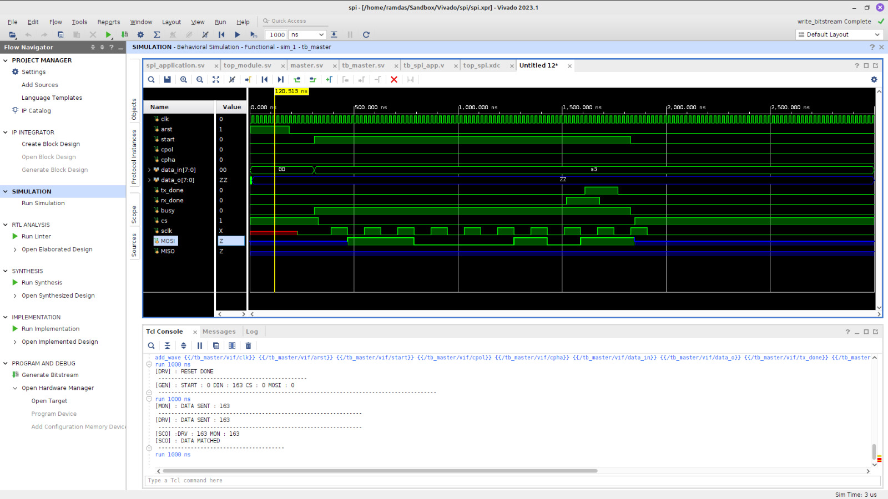

# SPI

An SPI master in SystemVerilog, plus a small application layer that talks to a
Winbond SPI chip. I ran it on a Basys3 board (Artix-7, `xc7a35tcpg236-1`).

## What's inside

| File | What it does |
|---|---|
| `rtl_code/master.sv` | SPI master: 8-bit transfers, all four SPI modes (CPOL/CPHA), SCLK = clk / 8, `tx_done` / `rx_done` / `busy` flags |
| `rtl_code/spi_application.sv` | State machine that sends a command: instruction byte → 3 address bytes → data byte for a write, or a read sequence |
| `rtl_code/top_module.sv` | Basys3 top: connects the master and the application layer, and shows the received byte on the 7-segment display |
| `testbench/tb_master.sv` | Class-based testbench for the master: transaction, generator, driver, monitor and scoreboard talking through mailboxes, with randomized data, CPOL and CPHA |
| `testbench/tb_top_module.sv` | Testbench for the full top module |
| `spi.zip` | The complete Vivado project (sources, constraints, runs) |

## Results

`result/` has screenshots from Vivado: the RTL schematic, synthesized and
implemented design, utilization report, power report, project summary and
waveforms. `output/` has logic-analyzer captures (Digilent WaveForms) of the
real SPI bus while the design ran on the board: chip select, clock, MOSI and MISO.

## Try it

Unzip `spi.zip` and open `spi/spi.xpr` in Vivado, or add the files from
`rtl_code/` and `testbench/` to a new project and run behavioral simulation.
